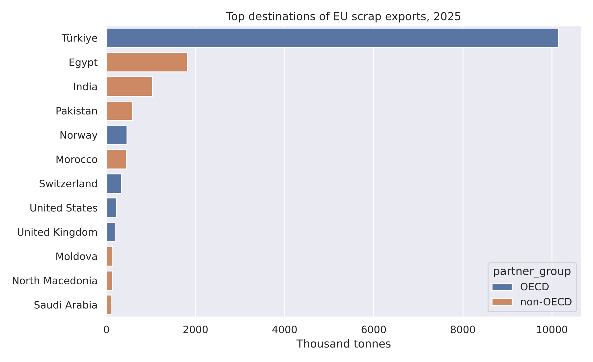
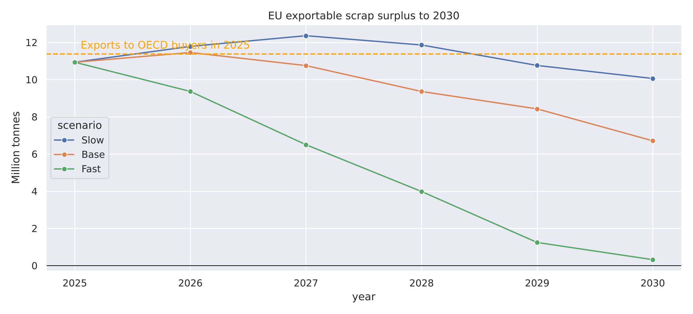
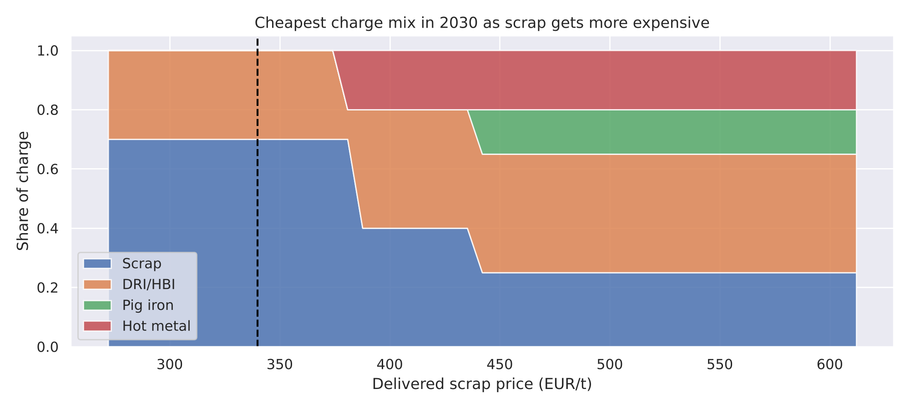

# Enough scrap for Europe's green steel?

Europe is building electric furnaces that make steel from scrap. Will there be enough scrap by 2030, and what should a steel plant do about it?

## The short version

Steel can be made in two ways. The old way melts iron ore with coal in a blast furnace, which emits a lot of CO2. The new way melts old steel (scrap: old cars, beams, cans) in an electric furnace, which emits much less.

European steelmakers are now building many of these electric furnaces. They all need scrap. Today Europe has more scrap than it uses and sells the extra abroad, mostly to Türkiye. From 2027 the EU also plans to stop most scrap exports to poorer (non-OECD) countries.

So two questions: will that extra scrap disappear by 2030, and what should a steel plant buying scrap do about it?

**My answer:** in the most likely case the extra shrinks from 10.9 to about 6.7 million tonnes by 2030. Europe still has some spare scrap, but less than its foreign buyers take today. Prices will likely rise, and a new plant like the one planned in Dunkirk could pay around 54 million euros more per year for scrap. It should secure scrap early through its own collection and long-term contracts.

Before my master's I worked in operations at a pig iron plant (Vedanta, Goa, India). Pig iron is one of the materials electric furnaces use besides scrap, so I wanted to look at the buying side of the same industry.

## What I found

### 1. Where does Europe's scrap go today?

In 2025 the EU sold 15.8 million tonnes of scrap outside Europe. Almost two thirds went to Türkiye. About 4.4 million tonnes went to countries the 2027 rule would block, like Egypt, India and Pakistan.



In the first nine months of 2026, exports to those countries still rose 18%.

Inside Europe, France has the most spare scrap (4.4 million tonnes) and Italy has the biggest shortage (5.9 million tonnes).

Europe also stopped buying pig iron and DRI (other iron materials for electric furnaces) from Russia in 2026. In 2022 Russia supplied about half.

### 2. How much spare scrap will be left in 2030?

I listed 20 announced electric furnace projects and built three scenarios: projects come late (slow), on a realistic timeline (base), or all on time (fast).



| Scenario | Spare scrap in 2030 |
|---|---|
| Slow | 10.1 Mt |
| Base | 6.7 Mt |
| Fast | 0.3 Mt |

The dashed line is what OECD countries (mainly Türkiye) bought in 2025. In the base case Europe can no longer supply all of it. What matters most is how much more scrap Europe collects each year.

### 3. What moves the scrap price?

The scrap price moves closely with pig iron, DRI and iron ore prices. It is hard to predict a month ahead. My models only beat the simple guess "same as last month" when predicting the change, not the level, and only slightly.

### 4. What should a new plant buy?

I took a 2 million tonne electric furnace in Dunkirk (based on ArcelorMittal's public plan for 2029) as an example.

- It needs about 1.06 million tonnes of scrap a year, which is a quarter of France's spare scrap.
- If scrap gets 15% more expensive, it pays about 54 million euros more per year. At 30%, about 78 million.
- I used linear programming to find the cheapest mix of materials. Below about 388 euros per tonne, scrap is cheapest. Above that, it is cheaper to use more DRI. Today scrap costs about 340 euros per tonne delivered.



Of the sourcing options I compared, its own scrap collection and long-term contracts with scrap suppliers scored best.

## Words used

- **Scrap**: used steel that is melted again
- **EAF (electric arc furnace)**: makes steel by melting scrap with electricity
- **Pig iron / DRI / HBI**: iron made from ore, mixed with scrap in an EAF when scrap is short or too dirty
- **OECD**: a group of 38 mostly rich countries. The EU rule would allow scrap exports to them but not to others
- **CBAM**: an EU charge on the CO2 in imported steel and iron, starting 2026
- **Mt**: million tonnes

## How I built it

| Step | File | What it does |
|---|---|---|
| 1 | `notebooks/01_trade_flows_EDA.ipynb` | Downloads EU trade data, cleans it, looks at exports, prices and countries |
| 2 | `notebooks/02_gap_scenarios_2030.ipynb` | Builds the 2030 scenarios project by project |
| 3 | `notebooks/03_price_drivers_model.ipynb` | Tests regression, decision tree and random forest for the scrap price |
| 4 | `notebooks/04_sourcing_case.ipynb` | Costs with CO2, cheapest mix (linear programming), sourcing options |
| | `powerbi/ScrapSqueeze.pbip` | Dashboard with 5 pages built on the results |

Tools: Python (pandas, seaborn, scikit-learn, scipy) and Power BI.

## Data

- [Eurostat Comext](https://ec.europa.eu/eurostat/comext/newxtweb/), EU trade by product, monthly from 2015. Read directly from the Eurostat API in notebook 1
- [World Bank commodity prices](https://www.worldbank.org/en/research/commodity-markets) (iron ore, coal, gas, oil). Read directly in notebook 3
- `data/raw/eaf_project_tracker.csv`: the 20 furnace projects, collected by hand from company announcements, with a link for each
- A few numbers from news articles (EU scrap use, scrap and HBI prices, CBAM price), linked in the notebooks

## Run it

```
pip install -r requirements.txt
```

Run the notebooks in order 1 to 4. For Power BI, open the `.pbip` file, set the `DataFolder` parameter to your own `data/processed` folder and refresh.

## Limits

- Some project sizes and start dates are my estimates from news.
- Prices from trade data are averages (value divided by tonnes), not market quotes.
- The hot metal cost and the sourcing scores are my own assumptions.
- The scenarios show what could happen, not a forecast.
